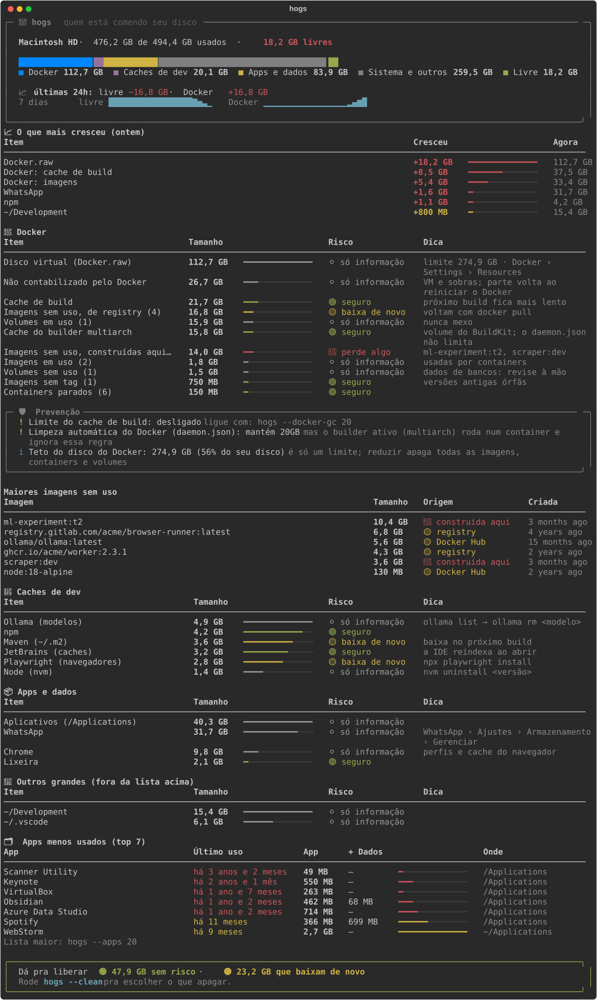
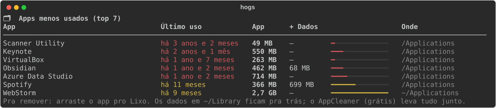

<div align="center">

# 🐷 hogs

**Descubra quem está comendo o disco do seu Mac, inclusive o que o macOS esconde em “Dados do Sistema”, e limpe com segurança.**

[](https://github.com/willlobato/hogs/actions/workflows/ci.yml)


[](LICENSE)



</div>

---

## Por quê?

Num Mac de 500 GB, quem desenvolve vive com o disco no limite. Você abre **Ajustes › Armazenamento** e vê uma barra cinza gigante chamada **“Dados do Sistema”**, sem nenhuma pista do que tem lá dentro.

Quase sempre é o **Docker**. O Docker Desktop guarda tudo num único arquivo, o `Docker.raw`, que cresce em silêncio com imagens antigas, cache de build e containers esquecidos. Fácil passar de 100 GB. Somam-se a isso os caches de npm, Maven, Gradle, JetBrains, Playwright e Ollama, e mais uns apps que você não abre há anos.

O `hogs` responde em uns 20 segundos:

- **pra onde foi o espaço**, separado por categoria, numa barra parecida com a do macOS mas mostrando o Docker de verdade;
- **o que dá pra apagar sem medo**, com uma etiqueta de risco em cada item;
- **e apaga pra você**, só o que você escolher, nunca o que está em uso;
- **o que está crescendo**, comparando com os dias anteriores;
- **e impede que o Docker volte a inchar**, limitando o cache de build sozinho.

## Instalação

**Requisitos:** macOS e Python 3.9+ (o `python3` do sistema serve). O Docker é opcional: sem ele, o hogs mostra o resto normalmente.

### Opção 1: um comando (recomendado)

```bash
curl -fsSL https://raw.githubusercontent.com/willlobato/hogs/main/install.sh | bash
```

O script baixa o `hogs.py` para `~/.local/share/hogs`, instala a biblioteca [`rich`](https://github.com/Textualize/rich) se faltar e cria o comando `~/.local/bin/hogs`. Se `~/.local/bin` não estiver no seu `PATH`, ele mostra a linha pra colocar no `~/.zshrc`.

### Opção 2: pipx

```bash
pipx install git+https://github.com/willlobato/hogs.git
```

### Opção 3: manual

```bash
git clone https://github.com/willlobato/hogs.git ~/Development/hogs
python3 -m pip install --user rich
ln -s ~/Development/hogs/hogs.py ~/.local/bin/hogs
```

Confira com `hogs --version`.

## Uso

| Comando | O que faz |
|---|---|
| `hogs` | Relatório completo: disco, Docker, caches de dev, apps e o que mais estiver grande |
| `hogs --clean` | Lista o que dá pra apagar e apaga só o que você escolher |
| `hogs --apps [N]` | Os N apps que você menos usa (padrão: 20) |
| `hogs --docker-gc 20` | Mantém o cache de build de cada builder abaixo de 20 GB, conferindo de hora em hora |
| `hogs --docker-gc off` | Desliga o limite do cache de build |
| `hogs --alert 30` | Liga o aviso automático quando o espaço livre cair abaixo de 30 GB |
| `hogs --alert` ou `hogs --docker-gc` | Mostra o que o agente está fazendo e o tamanho do histórico |
| `hogs --alert off` | Desliga o aviso |
| `hogs --alert test` | Manda uma notificação de exemplo |

### O que o relatório mostra

- **📈 O que mais cresceu:** comparado com o relatório de ontem, mais a variação das últimas 24h e uma minicurva dos últimos 7 dias do espaço livre e do Docker.
- **🐳 Docker:** tamanho real do `Docker.raw` e o limite configurado. Também imagens em uso, imagens sem uso (separando as que voltam com `docker pull` das que foram construídas na sua máquina), imagens sem tag, cache de build (inclusive o de builders `buildx` que rodam em container), containers parados, volumes, e o espaço que a VM do Docker ocupa sem contabilizar.
- **🛡 Prevenção:** se o cache de build tem limite, se a limpeza automática do Docker vale pro builder que você usa de verdade, se o TRIM está ligado e o teto do disco do Docker.
- **🧰 Caches de dev:** npm, Yarn, pnpm, pip, Homebrew, Maven, Gradle, Go, Cargo, JetBrains, VS Code, Xcode, Playwright, Ollama, nvm, pyenv, SDKMAN e simuladores iOS.
- **📦 Apps e dados:** WhatsApp, Chrome, Teams, a VM do Claude (Cowork), backups do iPhone, Downloads, Lixeira e `/Applications`.
- **🔎 Outros grandes:** qualquer pasta acima de 1 GB na sua home ou em `~/Library` que não esteja nas listas acima. É aqui que aparecem as surpresas.
- **🗂 Apps menos usados:** o top 10, com tamanho do app e dos dados dele.

## Limpeza segura

Cada item tem uma etiqueta de risco:

| | Significa | Exemplos |
|---|---|---|
| 🟢 **seguro** | Se recria sozinho, você não perde nada | cache de build do Docker, npm, caches da JetBrains, Lixeira |
| 🟡 **baixa de novo** | Volta, mas precisa baixar ou reconstruir | imagens de registry, `~/.m2`, navegadores do Playwright |
| 🔴 **perde algo** | Não volta sozinho, só apague se tiver certeza | imagens Docker construídas localmente |
| ⚪ **só informação** | O hogs mostra, mas não apaga | volumes, WhatsApp, Downloads, apps |

```text
$ hogs --clean
 #  Item                                   Tamanho  Risco
 1  Docker: cache de build                 21,7 GB  🟢 seguro
 2  npm                                     4,2 GB  🟢 seguro
 3  Imagem registry.gitlab.com/acme/…       6,8 GB  🟡 baixa de novo
 …
Quais apagar? a = todos 🟢 · ex: 1,3,5-7 · Enter cancela: a
```

Você escolhe por número (`1,3,5-7`) ou digita `a` para todos os 🟢. Antes de apagar, o hogs mostra o resumo e pede confirmação. No fim, diz quanto liberou.

**Garantias:**

- ❌ Nunca toca em **containers rodando** nem em **imagens usadas por algum container**.
- ❌ Nunca apaga **volumes do Docker**, porque é lá que ficam os dados dos seus bancos. A única exceção é o volume de estado de um builder `buildx`, que é só cache de build; mesmo assim o hogs não remove o volume, ele roda `docker buildx prune` nele.
- 🛡️ Um container parado de um projeto `docker compose` que ainda tem algo rodando nunca entra no grupo “seguro”.
- 🛡️ Imagens construídas localmente aparecem uma por uma, nunca em grupo.
- 🛡️ Não apaga a VM do Claude enquanto o app está aberto.
- Nada é apagado sem você confirmar.

## Prevenção: o Docker para de inchar

Limpar resolve hoje; o Docker volta a crescer amanhã. Quase sempre o culpado é o **cache de build**.

O Docker Desktop já vem com uma limpeza automática no `~/.docker/daemon.json` (`builder.gc`), mas **ela só vale pro builder padrão**. Se você usa um builder `buildx` criado com `docker buildx create` (comum pra builds multiplataforma), ele roda num container, guarda o cache num volume próprio e **ignora essa regra**. O painel 🛡 do relatório avisa quando é o seu caso.

```bash
hogs --docker-gc 20     # cada builder fica com no máximo 20 GB de cache
hogs --docker-gc off    # desliga
```

Ao ligar, o hogs aplica o limite na hora e depois confere **de hora em hora**: em cada builder rodando, executa `docker buildx prune --max-used-space 20gb`, que apaga só o cache **mais antigo** acima do limite. O que você usa no dia a dia continua em cache e seus builds seguem rápidos.

> [!NOTE]
> E o “Teto do disco do Docker” (Settings › Resources)? Ele é só um limite: o `Docker.raw` ocupa o que usa, não o teto. E **diminuir o teto apaga todas as imagens, containers e volumes** ([FAQ do Docker](https://docs.docker.com/desktop/troubleshoot-and-support/faqs/macfaqs/)), por isso o hogs só mostra o valor, sem sugerir mudar.

## Aviso automático

```bash
hogs --alert 30     # liga: avisa quando ficar abaixo de 30 GB livres
hogs --alert off    # desliga
```

Abaixo do limite, aparece uma notificação como esta:

> **💾 Disco quase cheio: 18 GB livres**
> Docker ocupa 95 GB (~40 GB liberáveis). Cresceu 17 GB em 24h. Rode hogs no terminal.

- No máximo **1 aviso a cada 6 horas**. Abaixo de 10 GB, vira **alerta crítico com som**, no máximo 1 por hora.

> [!TIP]
> Se a notificação de teste (`hogs --alert test`) não aparecer, libere as notificações do **Editor de Scripts** em *Ajustes do Sistema › Notificações*. O macOS envia notificações de script em nome dele.

## O agente e o histórico

`--alert` e `--docker-gc` usam o mesmo agente do `launchd` (o agendador do próprio macOS), que roda **a cada hora** e logo depois do login. A cada execução ele:

1. grava no histórico o espaço livre e o tamanho do `Docker.raw` (instantâneo, sem abrir o Docker);
2. aplica o limite do cache de build, se o `--docker-gc` estiver ligado;
3. avisa se o disco estiver enchendo, se o `--alert` estiver ligado.

Ligar qualquer um dos dois instala o agente; desligar os dois remove. Ele continua funcionando depois de reiniciar o Mac. `hogs --alert` (sem número) mostra o estado de tudo.

Cada `hogs` também grava um retrato completo (todos os itens), que é o que alimenta a tabela **📈 O que mais cresceu**. O histórico guarda 90 dias.

| Arquivo | O que é |
|---|---|
| `~/Library/LaunchAgents/dev.hogs.agent.plist` | o agente |
| `~/Library/Application Support/hogs/config.json` | o que está ligado |
| `~/Library/Application Support/hogs/history.jsonl` | o histórico |
| `~/Library/Logs/hogs.log` | o log do agente (o que ele limpou, avisos enviados) |

## Apps menos usados



```bash
hogs --apps        # top 20
hogs --apps 40     # quantos quiser
```

O hogs varre `/Applications` e `~/Applications` e ordena os apps pelo último uso. A coluna **+ Dados** soma o que o app deixa em `~/Library` (Containers, Application Support e Caches), espaço que continua ocupado se você só arrastar o app pro Lixo. O [AppCleaner](https://freemacsoft.net/appcleaner/) remove tudo junto.

## Como funciona

- **Tamanhos de pastas:** `du`, em paralelo. Os tamanhos estão em GB decimais, como no Finder.
- **Docker:** `docker system df -v`. Com o armazenamento containerd, a soma dos tamanhos “únicos” por imagem passa do total real, porque camadas compartilhadas entram mais de uma vez. Por isso o hogs ajusta as imagens proporcionalmente para que os totais batam com os do próprio Docker. O tamanho do `Docker.raw` é o espaço **realmente ocupado** no disco: o arquivo é esparso, então o tamanho nominal é só o limite.
- **De onde veio cada imagem:** o Docker não registra isso, então o hogs deduz pelo nome. Nome com endereço de registry (`ghcr.io/…`, `*.amazonaws.com/…`) ou com `usuario/` conta como baixável. Nome sem barra que não está na lista de imagens oficiais (`nginx`, `postgres`, …) conta como **construída aqui**. Na dúvida, o hogs marca como risco maior.
- **Último uso dos apps:** o hogs usa a data em que o executável do app foi lido pela última vez, que o macOS atualiza quando o app abre, combinada com a data do estado salvo da janela. Ele não depende do Spotlight, que às vezes está com o índice quebrado. A precisão é de dia, mas um antivírus que varre os executáveis pode “rejuvenescer” um app.

## Atualizar e desinstalar

**Atualizar:** rode o mesmo comando da instalação de novo, ou `pipx reinstall hogs`.

**Desinstalar:**

```bash
hogs --alert off; hogs --docker-gc off            # remove o agente, se estiver ligado
rm -rf ~/.local/share/hogs ~/.local/bin/hogs       # instalação via script
rm -rf ~/Library/Application\ Support/hogs        # configuração e histórico
pipx uninstall hogs                                # ou, se instalou com pipx
```

## Desenvolvimento

É um único arquivo, [`hogs.py`](hogs.py), e só depende do `rich`.

```bash
python3 -m unittest discover -s tests -v   # testes
python3 docs/make_screenshots.py           # regenera as imagens do README (dados fictícios)
```

Quer adicionar um cache ou app que o hogs ainda não conhece? É uma linha em `PATH_DEFS` dentro de `hogs.py`. PRs são bem-vindos.

## Licença

[MIT](LICENSE) © Will Lobato
