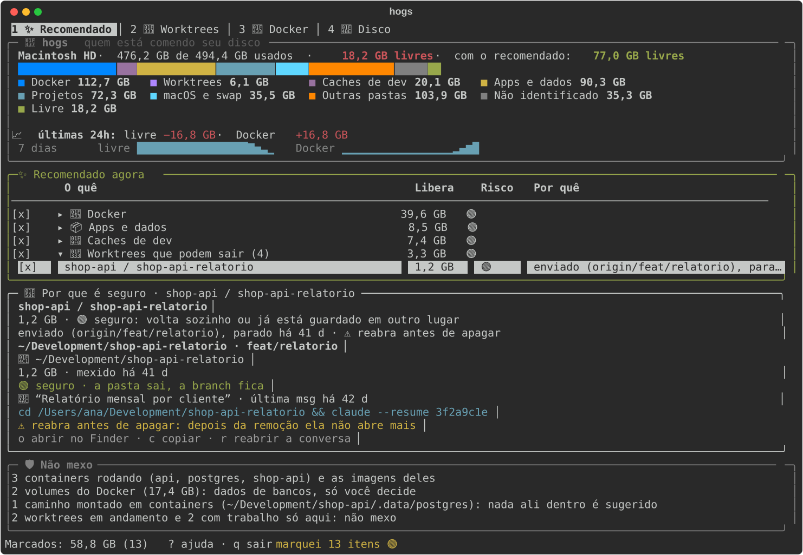
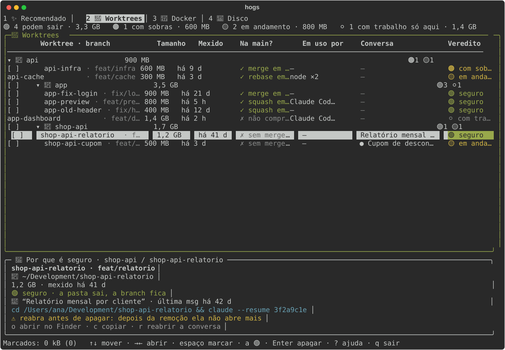

<div align="center">

# 🐷 hogs

**Descubra quem está comendo o disco do seu Mac, inclusive o que o macOS esconde em “Dados do Sistema”, e limpe com segurança.**

[](https://github.com/willlobato/hogs/actions/workflows/ci.yml)


[](LICENSE)



</div>

---

## Por quê?

Num Mac de 500 GB, quem desenvolve vive com o disco no limite. Você abre **Ajustes › Armazenamento** e vê uma barra cinza gigante chamada **“Dados do Sistema”**, sem nenhuma pista do que tem lá dentro.

Quase sempre é o **Docker**. O Docker Desktop guarda tudo num único arquivo, o `Docker.raw`, que cresce em silêncio com imagens antigas, cache de build e containers esquecidos. Fácil passar de 100 GB. Somam-se a isso os caches de npm, Maven, Gradle, JetBrains, Playwright e Ollama, e mais uns apps que você não abre há anos.

O `hogs` responde em uns 20 segundos:

- **pra onde foi o espaço**, numa barra parecida com a do macOS mas separada em partes com nome: Docker, caches de dev, apps, projetos, macOS e swap, outras pastas e o que sobra sem identificar;
- **o que dá pra apagar sem medo**, com uma etiqueta de risco em cada item e um resumo do que é recomendado agora;
- **e apaga pra você**, numa tela com teclado e mouse: você marca, confere a lista e confirma; nunca o que está em uso;
- **o que está crescendo**, comparando com os dias anteriores;
- **e impede que o Docker volte a inchar**, limitando o cache de build sozinho.

## Instalação

**Requisitos:** macOS e Python 3.9+ (o `python3` do sistema serve). O Docker é opcional: sem ele, o hogs mostra o resto normalmente.

### Opção 1: um comando (recomendado)

```bash
curl -fsSL https://raw.githubusercontent.com/willlobato/hogs/main/install.sh | bash
```

O script baixa o `hogs.py` para `~/.local/share/hogs`, instala a biblioteca [`rich`](https://github.com/Textualize/rich) se faltar e cria o comando `~/.local/bin/hogs`. Se `~/.local/bin` não estiver no seu `PATH`, ele mostra a linha pra colocar no `~/.zshrc`.

### Opção 2: pipx

```bash
pipx install git+https://github.com/willlobato/hogs.git
```

### Opção 3: manual

```bash
git clone https://github.com/willlobato/hogs.git ~/Development/hogs
python3 -m pip install --user rich
ln -s ~/Development/hogs/hogs.py ~/.local/bin/hogs
```

Confira com `hogs --version`.

## Uso

| Comando | O que faz |
|---|---|
| `hogs` | Num terminal, abre a [tela interativa](#tela-interativa): disco por partes, o que é recomendado agora, worktrees, Docker e tudo o que dá pra apagar, para marcar e apagar. Fora de um terminal (saída redirecionada, agente), imprime o relatório |
| `hogs --report` | Imprime o relatório estático, mesmo num terminal: disco por partes, o que é recomendado agora, o que o hogs não mexe, Docker, caches de dev, apps e o que mais estiver grande |
| `hogs --worktrees PASTA` | Abre a tela na aba Worktrees, só com os worktrees Git de PASTA (sem medir o disco); a pasta fica lembrada para o relatório principal |
| `hogs --worktrees PASTA --report` | Imprime o quadro por projeto: quem usa cada worktree, quando mudou, merge, envio, conversa do Claude Code e se é seguro apagar |
| `hogs --worktrees PASTA --worktree-days 3` | Só considera seguro o que está há 3 dias sem mudança (padrão: sem mínimo) |
| `hogs --no-mouse` | A tela sem mouse (só teclado) |
| `hogs --clean` | O mesmo que `hogs`: abre a tela para escolher o que apagar. Fora de um terminal (ou com `--report`), imprime o relatório e avisa no stderr por que não abriu a tela (sai com código 2) |
| `hogs --apps [N]` | Os N apps que você menos usa (padrão: 20) |
| `hogs --docker-gc 20` | Mantém o cache de build de cada builder abaixo de 20 GB, conferindo de hora em hora |
| `hogs --docker-gc off` | Desliga o limite do cache de build |
| `hogs --alert 30` | Liga o aviso automático quando o espaço livre cair abaixo de 30 GB |
| `hogs --alert` ou `hogs --docker-gc` | Mostra o que o agente está fazendo e o tamanho do histórico |
| `hogs --alert off` | Desliga o aviso |
| `hogs --alert test` | Manda uma notificação de exemplo |

### Tela interativa

Num terminal, `hogs` abre uma tela com quatro abas. Nada vem marcado: você marca o que quer apagar, tecla
Enter, confere a lista e confirma com `s`.

- **✨ Recomendado:** a barra do disco, o histórico e só os itens 🟢, agrupados por bloco (os worktrees 🟢
  entram um por um no grupo 🌳); as ações do macOS (↻) e, à parte, os 🟡 para avaliar. Embaixo, o 🔎 diz
  por que cada item é seguro, com o que o hogs conferiu (✓ passou, ✗ não passou), e o 🛡 o que o hogs não mexe.
- **🌳 Worktrees:** um grupo por projeto, com tamanho, quando mudou, merge, quem usa, conversa e veredito
  de cada worktree. `f` filtra por veredito.
- **🐳 Docker:** cache e sobras de build, pontos de volta, containers parados, todas as imagens com origem,
  quem usa e os dados montados (`f` filtra: em uso, sem uso, construídas aqui; as pequenas do registry/Hub
  saem juntas num item, com cada uma listada dentro dele) e, só como informação, os containers rodando e os
  volumes.
- **💾 Disco:** todos os itens por bloco (Docker, caches de dev, apps e dados, worktrees, macOS e swap,
  outros grandes), com qualquer risco: é aqui que ficam os 🟡 e os 🔴.



| Tecla | O que faz |
|---|---|
| ↑ ↓ | move o cursor (PgUp/PgDn, Home/End também) |
| → ← | abre e fecha um grupo |
| espaço | marca ou desmarca; num grupo, só os 🟢 dele (🟡 e 🔴 só um por um; grupo sem 🟢 não tem caixinha) |
| `a` | marca todos os 🟢 da aba |
| Enter | mostra a lista do que vai sair (↑↓, PgUp/PgDn e a rodinha rolam), o total e os avisos; `s` apaga, `n` ou Esc volta. Numa linha ↻, só mostra como fazer |
| `c` | copia o comando de reabrir a conversa do Claude Code, ou o caminho |
| `o` | mostra a pasta no Finder |
| `r` | reabre a conversa do Claude Code ligada ao worktree (`claude --resume`) |
| `e` | explora: leva à aba Disco, no bloco do item em foco |
| `f` | troca o filtro (abas Worktrees e Docker) |
| `1`–`4`, Tab | troca de aba |
| `?` | ajuda |
| `q` | sai (Ctrl-C também; Esc só fecha a ajuda e a confirmação) |

**Mouse:** clique numa linha leva o foco até ela; clique na caixinha `[ ]` marca; clique numa aba troca de
aba; a rodinha rola. Para selecionar texto com o mouse ligado, segure Option enquanto arrasta (iTerm2).
`hogs --no-mouse` desliga o mouse.

Na hora de apagar, cada item é conferido de novo (app aberto, worktree mexido, comando que falha): o que
saiu aparece com ✔ e some da tela; o que ficou aparece com ↷ e o motivo, e continua na lista. Depois de
remover worktrees, o resultado mostra o comando para recriar um (`git -C <repo> worktree add <pasta> <branch>`).
Os números do topo são os da última medição: rode `hogs` de novo para medir. A tela nunca abre sem um terminal de verdade
e, ao sair (inclusive por erro ou Ctrl-C), o terminal volta ao normal.

### O que o relatório mostra

O relatório estático (`hogs --report`, ou `hogs` fora de um terminal) traz os mesmos blocos, sem interação.


- **🐷 Barra do disco:** o usado em partes (Docker, worktrees, caches de dev, apps e dados, projetos, macOS e swap, outras pastas, não identificado) e o livre, sem contar nada duas vezes: a soma das partes é o usado. **Worktrees** sai de dentro de **Projetos** (a pasta `worktrees_root`), não se soma a ela. **macOS e swap** são os volumes do sistema (System, Preboot, VM com o swap…), lidos do `diskutil`. Ao lado do livre, quanto ficaria livre **com o recomendado**.
- **🌳 Worktrees:** logo abaixo da barra, quantos worktrees há na pasta dos projetos, quanto ocupam, quantos podem sair, quantos estão em andamento e quantos têm trabalho só ali, com o comando do quadro detalhado. Precisa de `worktrees_root`: rode `hogs --worktrees PASTA` uma vez e a pasta fica lembrada; até lá, a linha diz isso.
- **✨ Recomendado agora:** só os itens 🟢, agrupados por bloco (os worktrees 🟢 entram como um grupo 🌳, com quantos estão na main, quantos são enviados e parados e quantas conversas reabrir antes); as ações do macOS que liberam espaço (↻ reiniciar quando o swap está alto e o Mac ligado há muitos dias, ↻ aplicar uma atualização já baixada), que o hogs só recomenda; e linhas à parte com os arquivos parados e os pontos de volta recentes (cada um pelo nome), para você avaliar. Se um item 🟢 depende de fechar um app, o motivo aparece ali.
- **🛡 Não mexo:** o que fica protegido: containers rodando e as imagens deles, volumes do Docker, pastas montadas por containers e, com `worktrees_root`, quantos worktrees estão em andamento ou com trabalho só aqui.
- **📈 O que mais cresceu:** comparado com o relatório de ontem, mais a variação das últimas 24h e uma minicurva dos últimos 7 dias do espaço livre e do Docker.
- **🐳 Docker:** tamanho real do `Docker.raw` e o limite configurado. Também imagens em uso, imagens sem uso (separando as que voltam com `docker pull` das que foram construídas na sua máquina), imagens sem tag, pontos de volta (cada um na sua linha, com o mesmo risco da tela), cache de build (inclusive o de builders `buildx` que rodam em container), containers parados, volumes, e o espaço que a VM do Docker ocupa sem contabilizar.
- **🛡 Prevenção:** se o cache de build tem limite, se a limpeza automática do Docker vale pro builder que você usa de verdade, se o TRIM está ligado e o teto do disco do Docker. Também por quanto tempo o Claude Code guarda as conversas (`cleanupPeriodDays` em `~/.claude/settings.json`, ou na pasta de `CLAUDE_CONFIG_DIR` se definida; 30 dias se não estiver definido): o hogs recomenda aumentar, mas nunca altera o arquivo.
- **🧰 Caches de dev:** npm, Yarn, pnpm, pip, Homebrew, Maven, Gradle, Go, Cargo, JetBrains, VS Code, Xcode, Playwright, Ollama, nvm, pyenv, SDKMAN e simuladores iOS.
- **📦 Apps e dados:** WhatsApp, Chrome, Teams, a VM do Claude (Cowork), backups do iPhone, Downloads, Lixeira e `/Applications`. Também as cópias antigas que alguns apps (como o Chrome) deixam em pastas `*.code_sign_clone` depois de atualizar, e arquivos grandes (500 MB+) na Mesa, Documentos, Downloads e Imagens sem abrir há mais de 6 meses (🟡 para avaliar: vão para a Lixeira).
- **🧰 Caches grandes:** pastas de `~/Library/Caches` acima de 500 MB que não estão na lista entram como 🟡 (o app recria).
- **🔎 Outros grandes:** qualquer pasta acima de 1 GB na sua home ou em `~/Library` que não esteja nas listas acima. É aqui que aparecem as surpresas.
- **🗂 Apps menos usados:** o top 10, com tamanho do app e dos dados dele.

## Limpeza segura

Cada item tem uma etiqueta de risco:

| | Significa | Exemplos |
|---|---|---|
| 🟢 **seguro** | Se recria sozinho, você não perde nada | cache de build do Docker, npm, caches da JetBrains, Lixeira |
| 🟡 **baixa de novo** | Volta, mas precisa baixar ou reconstruir | imagens de registry, `~/.m2`, navegadores do Playwright |
| 🔴 **perde algo** | Não volta sozinho, só apague se tiver certeza | imagens Docker construídas localmente |
| ⚪ **só informação** | O hogs mostra, mas não apaga | volumes, WhatsApp, Downloads, apps |

Na [tela](#tela-interativa), nada vem marcado. `a` marca só os 🟢; os 🟡 e os 🔴 você marca um por um. Enter mostra o que vai sair, o total e um aviso se houver item 🔴; só `s` apaga. No fim, o hogs diz quanto liberou.

**Garantias:**

- ❌ Nunca toca em **containers rodando** (pausados ou reiniciando contam como rodando) nem em **imagens usadas por algum container**.
- ❌ Nunca apaga **volumes do Docker**, porque é lá que ficam os dados dos seus bancos. A única exceção é o volume de estado de um builder `buildx`, que é só cache de build; mesmo assim o hogs não remove o volume, ele roda `docker buildx prune` nele.
- 🛡️ Um container parado de um projeto `docker compose` que ainda tem algo rodando nunca entra no grupo “seguro”.
- 🛡️ Um container cuja idade o Docker não informa nunca conta como “parado há +30 dias”; um que nunca foi iniciado conta a partir da criação.
- 🛡️ Imagem sem tag baixada por digest (`postgres@sha256:…`) é removida pelo digest, nunca por `docker rmi postgres` (que seria a `postgres:latest`).
- Se um comando de limpeza falha, ou algo mudou entre marcar e confirmar (app aberto, worktree mexido), o item aparece como mantido (↷), com o motivo, e não como apagado.
- 🛡️ Imagens construídas localmente aparecem uma por uma, nunca em grupo.
- 🛡️ Pontos de volta de imagens (`antes-*`, `backup-*`…) só viram 🟢 depois de `rollback_days` dias (padrão 2, configurável), contados a partir do sinal mais recente; antes disso ficam 🟡 para avaliar.
- 🛡️ Se a imagem atual foi construída com as etiquetas OCI de commit e origem (`docker build --label org.opencontainers.image.revision=$(git rev-parse HEAD) --label org.opencontainers.image.source=https://github.com/acme/shop-api .`) e o commit da imagem atual já está na branch padrão de um clone em `worktrees_root`, a do remoto que bate com a etiqueta de origem (`<remoto>/HEAD`, senão `<remoto>/main` ou `<remoto>/master`), os pontos de volta dela ficam 🟢 na hora, mesmo os recentes. A revisão precisa ser o SHA de um commit: uma tag ou branch local com nome hexadecimal não vale. A checagem é local (nunca faz `git fetch`); sem etiquetas, sem `worktrees_root` ou sem clone, vale o prazo de `rollback_days`.
- 🛡️ Não apaga a VM do Claude enquanto o app está aberto.
- 🛡️ Arquivo pessoal só vai para a Lixeira, nunca é apagado direto.
- 🛡️ Worktree só sai por `git worktree remove`, sem `--force`, e a branch fica. Tudo é conferido de novo logo antes de cada remoção, inclusive o envio e as conversas do Claude Code; o que mudou desde a análise fica.
- 🛡️ Num worktree já na main, arquivos fora do Git só saem se você marcar o worktree (🟠, nunca pelo `a`), e vão para a Lixeira, nunca apagados direto. Alteração em arquivo versionado, ou arquivo fora do Git num worktree sem merge, segura o worktree.
- 🛡️ Nenhuma pasta montada por um container (rodando ou parado) é sugerida, nem nada dentro dela. Vale também para a pasta por trás de um volume nomeado com bind (`--opt o=bind --opt device=/pasta`, comum em compose de banco). Se o Docker está instalado mas não responde e não há uma lista salva, o hogs não sugere arquivos parados nem caches grandes de apps.
- 🛡️ Cópias antigas de apps só saem com o app fechado, e só as de versões diferentes da instalada. O app conta como aberto se o nome do executável, o nome cortado pelo macOS ou o caminho dele aparecer nos processos.
- 🛡️ Reiniciar o Mac e aplicar atualizações do macOS são só recomendações: o hogs nunca executa essas ações e elas nunca entram na limpeza nem no “com o recomendado”.
- O “com o recomendado” soma só os itens 🟢; os 🟡 para avaliar ficam de fora. Com o TRIM do Docker desligado, o que se apaga no Docker não volta ao macOS: ele fica fora da conta e o cabeçalho avisa.
- Nada vem marcado ao abrir a tela, `a` marca só os 🟢 e nada é apagado sem você ver a lista e confirmar com `s`.
- 🛡️ Containers rodando e volumes aparecem na aba Docker só como informação, sem caixinha. As ações do macOS (↻) também nunca têm caixinha.

## Worktrees Git

```bash
hogs --worktrees ~/Development            # a tela, na aba Worktrees
hogs --worktrees ~/Development --report   # o quadro abaixo
```


A análise é somente leitura e fica limitada aos worktrees registrados dentro da pasta escolhida, que
fica lembrada (`worktrees_root`) para o relatório principal mostrar a linha 🌳 e o grupo no ✨ Recomendado.
Um quadro por projeto mostra, para cada worktree: pasta e branch, tamanho, **há quanto tempo mudou**,
se **já foi mergeado** ou **enviado**, **quem usa ou usou** (sessão do Claude Code pelo nome, Codex,
processos como `node ×3`, containers), a **conversa** do Claude Code ligada a ele e o veredito:

- 🟢 **já na main**: mergeado, limpo e sem nada rodando dentro. Pode apagar.
- 🟢 **parado e enviado**: sem merge, mas parado há mais de `stale_worktree_days` dias (padrão 30), com
  tudo commitado, o HEAD já enviado a uma branch remota e nenhuma conversa do Claude Code nesse prazo.
  A pasta sai, a branch fica.
- 🟡 **em andamento**: algo roda dentro da pasta agora (dev server, container, sessão aberta dentro
  dela), ou está sem merge e foi mexido ou conversado nos últimos `stale_worktree_days` dias.
- 🟠 **com sobras**: já na main, sem alteração em arquivo versionado e sem nada rodando dentro, mas com
  arquivos que o Git não guarda (não versionados, `.env`, anotações). Você decide: se marcar, esses
  arquivos vão para a **Lixeira** e a pasta sai; a branch fica.
- ⚪ **com trabalho só aqui**: commits que não estão na branch principal nem foram enviados, alterações em
  arquivos versionados, arquivos fora do Git num worktree sem merge, ou ficou dúvida. Não apague.

Por último vem o **resumo**: quantos são 🟢 e por quê, quais sessões abertas trabalharam neles, o que
falta para os 🟡, por que cada grupo ⚪ fica, e o que fazer, com o comando pronto.

Para apagar, abra a tela (`hogs --worktrees PASTA` ou `hogs`, num terminal): na aba Worktrees, só os 🟢
têm caixinha. Marque com espaço (`a` marca todos os 🟢), tecle Enter para ver o que vai sair, o total e as
conversas para reabrir antes, e confirme com `s`. Cada worktree é conferido de novo na hora da remoção; o
que mudou desde a análise fica, com o motivo.

Os 🟠 também têm caixinha, mas o `a` não os pega: marque um por um. A confirmação lista cada arquivo fora
do Git que vai para a Lixeira. Na hora de apagar, tudo é conferido de novo; se apareceu um arquivo fora do
Git que não estava na lista, nada é mexido. Um link simbólico fora do Git sai só como atalho: o arquivo
para onde ele aponta fica onde está. Depois, a pasta sai com `git worktree remove`, sem `--force`.

Um worktree 🟢 precisa passar por **todas** as condições:

- sem alterações nem arquivos não versionados;
- HEAD já incorporado à principal (`origin/HEAD`, ou `origin/main`/`origin/master` locais), por
  merge, rebase ou squash: rebase e squash são comprovados por patch-id, só lendo o repositório.
  **Ou**, sem merge: HEAD contido numa branch remota, nada mexido nem conversado no Claude Code há
  `stale_worktree_days` dias e nenhuma sessão aberta que o cite;
- ignorados só regeneráveis: `node_modules`, `target`, `build`, `dist`, `.docusaurus`, `.gradle`,
  caches de Python etc. Qualquer outro ignorado (`.env`, `.terraform`, `.superpowers`, certificados)
  bloqueia e aparece no motivo;
- nada rodando dentro da pasta: nenhum processo com arquivo aberto ou cwd nela (`lsof`), nenhum
  container montando-a e nenhuma sessão do Claude Code aberta dentro dela.

Com isso, apagar não perde nada: o trabalho está na main ou no remoto, e a branch fica.

**Enviado** quer dizer que o HEAD está numa referência remota **local** (`origin/feat/x`, o que o último
`git fetch` ou `git push` deixou). O hogs não acessa a rede: rode `git fetch` nos repositórios antes da
análise. Commits que só existem na máquina deixam o worktree ⚪ em qualquer idade.

**Sessões abertas não impedem os que já estão na main.** Uma sessão do Claude Code viva
(`~/.claude/sessions`) que trabalhou no worktree (o caminho aparece num comando, arquivo ou texto da
conversa atual, inclusive de subagentes; saída de comando não conta) é mostrada pelo nome, assim como
sessões do Codex e do Claude Code abertas na pasta nos últimos 7 dias. É informação para você decidir; a
sessão só perde a pasta. Sem merge é diferente: uma sessão aberta que o cite deixa o worktree 🟡.

**Coluna Conversa.** Mostra a conversa do Claude Code mais recente ligada ao worktree: o título, há
quanto tempo, `●` se está aberta agora e `+N` se há outras. Uma conversa se liga a um worktree quando
trabalhou numa pasta dentro dele, trabalhou na branch dele em outra pasta do mesmo repositório ou citou um
caminho dele. Como o APFS, a ligação não diferencia maiúsculas e segue symlinks; um worktree a mais de 8
níveis da pasta escolhida casa pelos 8 primeiros (na dúvida, liga). Se **alguma** das conversas ligadas
**começou** dentro da pasta (não só a mostrada), aparece `⚠ reabra antes de apagar`: o
`claude --resume` acha a conversa pela pasta onde ela começou, então o resumo traz o comando pronto
(`cd … && claude --resume …`) de cada uma para você retomá-las antes que a pasta saia.

As conversas vêm de `~/.claude/projects` (ou da pasta de `CLAUDE_CONFIG_DIR`, se definida), só lidas, e ficam num cache em
`~/Library/Application Support/hogs/conversations.json`: cada transcrição é lida só a partir de onde
parou, então da segunda análise em diante as conversas levam uma fração de segundo. O Claude Code apaga conversas depois de 30 dias se
`cleanupPeriodDays` não estiver definido; o painel 🛡 Prevenção avisa.

`--worktree-days N` exige N dias sem mudança (arquivos ou metadados Git: commit, checkout, add) para
um worktree ser 🟢. O padrão é sem mínimo. Arquivos em pastas regeneráveis (`node_modules`, `target`…)
não contam como mudança.

Se `lsof` falhar ou o Docker estiver instalado mas não responder, a análise fica inconclusiva e não
oferece remoção. Checkouts principais, worktrees bloqueados, HEAD destacado, submódulos e worktrees
contendo outros worktrees também são preservados.

A verificação de merge usa as referências **locais**, sem rede nem `fetch` automático. Atualize-as com
`git fetch origin` no repositório antes da análise. Squash que não bate exatamente com a branch (conflito
resolvido, commit depois do merge) aparece como “merge não comprovado”.

A remoção usa `git worktree remove`, sem `--force`. As branches permanecem e permitem recriar o
checkout: o resultado na tela mostra o comando (`git -C <repo> worktree add <pasta> <branch>`). Os tamanhos são estimativas (blocos compartilhados no APFS). Nada é removido automaticamente.

## Prevenção: o Docker para de inchar

Limpar resolve hoje; o Docker volta a crescer amanhã. Quase sempre o culpado é o **cache de build**.

O Docker Desktop já vem com uma limpeza automática no `~/.docker/daemon.json` (`builder.gc`), mas **ela só vale pro builder padrão**. Se você usa um builder `buildx` criado com `docker buildx create` (comum pra builds multiplataforma), ele roda num container, guarda o cache num volume próprio e **ignora essa regra**. O painel 🛡 do relatório avisa quando é o seu caso.

```bash
hogs --docker-gc 20     # cada builder fica com no máximo 20 GB de cache
hogs --docker-gc off    # desliga
```

Ao ligar, o hogs aplica o limite na hora e depois confere **de hora em hora**: em cada builder rodando, executa `docker buildx prune --max-used-space 20gb`, que apaga só o cache **mais antigo** acima do limite. O que você usa no dia a dia continua em cache e seus builds seguem rápidos.

> [!NOTE]
> E o “Teto do disco do Docker” (Settings › Resources)? Ele é só um limite: o `Docker.raw` ocupa o que usa, não o teto. E **diminuir o teto apaga todas as imagens, containers e volumes** ([FAQ do Docker](https://docs.docker.com/desktop/troubleshoot-and-support/faqs/macfaqs/)), por isso o hogs só mostra o valor, sem sugerir mudar.

## Aviso automático

```bash
hogs --alert 30     # liga: avisa quando ficar abaixo de 30 GB livres
hogs --alert off    # desliga
```

Abaixo do limite, aparece uma notificação como esta:

> **💾 Disco quase cheio: 18 GB livres**
> Docker ocupa 95 GB (~40 GB liberáveis). Cresceu 17 GB em 24h. Rode hogs no terminal.

- No máximo **1 aviso a cada 6 horas**. Abaixo de 10 GB, vira **alerta crítico com som**, no máximo 1 por hora.

> [!TIP]
> Se a notificação de teste (`hogs --alert test`) não aparecer, libere as notificações do **Editor de Scripts** em *Ajustes do Sistema › Notificações*. O macOS envia notificações de script em nome dele.

## O agente e o histórico

`--alert` e `--docker-gc` usam o mesmo agente do `launchd` (o agendador do próprio macOS), que roda **a cada hora** e logo depois do login. A cada execução ele:

1. grava no histórico o espaço livre e o tamanho do `Docker.raw` (instantâneo, sem abrir o Docker);
2. aplica o limite do cache de build, se o `--docker-gc` estiver ligado;
3. avisa se o disco estiver enchendo, se o `--alert` estiver ligado.

Ligar qualquer um dos dois instala o agente; desligar os dois remove. Ele continua funcionando depois de reiniciar o Mac. `hogs --alert` (sem número) mostra o estado de tudo.

Cada `hogs` também grava um retrato completo (todos os itens), que é o que alimenta a tabela **📈 O que mais cresceu**. O histórico guarda 90 dias.

| Arquivo | O que é |
|---|---|
| `~/Library/LaunchAgents/dev.hogs.agent.plist` | o agente |
| `~/Library/Application Support/hogs/config.json` | o que está ligado |
| `~/Library/Application Support/hogs/history.jsonl` | o histórico |
| `~/Library/Application Support/hogs/conversations.json` | o cache das conversas do Claude Code ligadas aos worktrees (relatório e `--worktrees`) |
| `~/Library/Logs/hogs.log` | o log do agente (o que ele limpou, avisos enviados) |

### Configuração (`config.json`)

Além do que o `--alert`, o `--docker-gc` e o `--worktrees` gravam, dá para ajustar à mão:

| Chave | Padrão | O que faz |
|---|---|---|
| `rollback_tags` | `["antes", "backup", "bkp", "before", "rollback"]` | palavras que marcam uma tag como ponto de volta (`antes-*`, `v2-backup-*`…); só conta se a imagem atual do mesmo repositório existe |
| `rollback_days` | `2` | dias até um ponto de volta virar 🟢; não precisa esperar se o commit da imagem atual (etiqueta OCI) já está na branch padrão de um clone em `worktrees_root` |
| `stale_worktree_days` | `30` | dias sem mexer nem conversar no Claude Code para um worktree sem merge, mas enviado, virar 🟢 |
| `worktrees_root` | nenhum | pasta dos seus projetos, lembrada do último `hogs --worktrees PASTA`; se existir, aparece medida como **Projetos** na barra, liga a linha 🌳 Worktrees e o grupo de worktrees no relatório principal e é onde a regra OCI procura os clones |

Valor inválido (tipo errado, zero ou negativo) volta ao padrão.

## Apps menos usados


```bash
hogs --apps        # top 20
hogs --apps 40     # quantos quiser
```

O hogs varre `/Applications` e `~/Applications` e ordena os apps pelo último uso. A coluna **+ Dados** soma o que o app deixa em `~/Library` (Containers, Application Support e Caches), espaço que continua ocupado se você só arrastar o app pro Lixo. O [AppCleaner](https://freemacsoft.net/appcleaner/) remove tudo junto.

## Como funciona

- **Tamanhos de pastas:** `du`, em paralelo. Os tamanhos estão em GB decimais, como no Finder.
- **Docker:** `docker system df -v`. Com o armazenamento containerd, a soma dos tamanhos “únicos” por imagem passa do total real, porque camadas compartilhadas entram mais de uma vez. Por isso o hogs ajusta as imagens proporcionalmente para que os totais batam com os do próprio Docker. O tamanho do `Docker.raw` é o espaço **realmente ocupado** no disco: o arquivo é esparso, então o tamanho nominal é só o limite.
- **De onde veio cada imagem:** o Docker não registra isso, então o hogs deduz pelo nome. Nome com endereço de registry (`ghcr.io/…`, `*.amazonaws.com/…`) ou com `usuario/` conta como baixável. Nome sem barra que não está na lista de imagens oficiais (`nginx`, `postgres`, …) conta como **construída aqui**. Na dúvida, o hogs marca como risco maior.
- **Último uso dos apps:** o hogs usa a data em que o executável do app foi lido pela última vez, que o macOS atualiza quando o app abre, combinada com a data do estado salvo da janela. Ele não depende do Spotlight, que às vezes está com o índice quebrado. A precisão é de dia, mas um antivírus que varre os executáveis pode “rejuvenescer” um app.

## Atualizar e desinstalar

**Atualizar:** rode o mesmo comando da instalação de novo, ou `pipx reinstall hogs`.

**Desinstalar:**

```bash
hogs --alert off; hogs --docker-gc off            # remove o agente, se estiver ligado
rm -rf ~/.local/share/hogs ~/.local/bin/hogs       # instalação via script
rm -rf ~/Library/Application\ Support/hogs        # configuração e histórico
pipx uninstall hogs                                # ou, se instalou com pipx
```

## Desenvolvimento

É um único arquivo, [`hogs.py`](hogs.py), e só depende do `rich`.

```bash
python3 -m unittest discover -s tests -v   # testes
python3 docs/make_screenshots.py           # regenera as imagens do README (dados fictícios)
```

Quer adicionar um cache ou app que o hogs ainda não conhece? É uma linha em `PATH_DEFS` dentro de `hogs.py`. PRs são bem-vindos.

## Licença

[MIT](LICENSE) © Will Lobato
